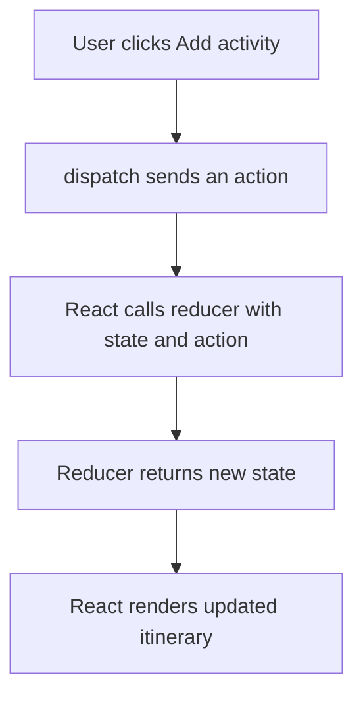
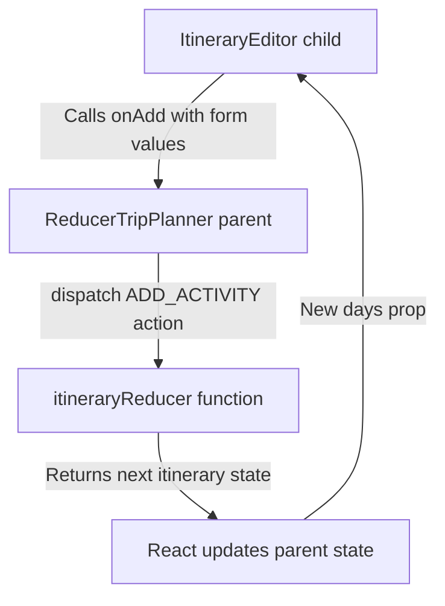

# ✈️ Class 29 Study Guide: Understanding React Reducers

> **Code 401 · React review · Beginner-friendly guide**
> **Big idea:** A reducer is a function that receives the **current state** and an **action** (a message describing what happened), then returns the **next state**.

---

## 🎯 Learning goal

By the end of this guide, you should be able to explain **why a reducer is useful**, identify its **two parameters**, describe how **`useReducer` and `dispatch` work together**, and write a simple reducer that adds, removes, or resets trip activities.

## 1. First, remember `useState` from Class 27

`useState` works well when a component needs to remember a simple value, such as the number of travelers.

```jsx
import { useState } from 'react';

function TravelerCounter() {
  const [travelers, setTravelers] = useState(2);

  return (
    <button onClick={() => setTravelers((old) => old + 1)}>
      Travelers: {travelers}
    </button>
  );
}
```

**Read this in plain English:**

- `travelers` = the current number React remembers.
- `setTravelers` = the function that asks React to update that number.
- `2` = the starting number.

But what if a trip planner needs to **add activities, remove activities, move activities, and reset the itinerary**? You *can* do that with `useState`, but several different update functions can become difficult to organize.

**That is where `useReducer` can help.** It puts the rules for changing related state into **one function**.

## 2. What is a reducer?

Think of a reducer as a **trip-planning desk**.

You give the desk two things:

1. **The current trip plan** — what the itinerary looks like right now.
2. **A request** — what you want to do, such as “add a museum visit.”

The desk uses the request to create the **updated trip plan** and gives that plan back.

```js
function itineraryReducer(state, action) {
  // Read the request and return the next state.
}
```

### The reducer's two parameters

| Parameter | Simple meaning | Example |
|---|---|---|
| `state` | The information **before** the change | `{ activities: ['Museum'] }` |
| `action` | An object describing **what should happen** | `{ type: 'ADD_ACTIVITY', payload: 'Beach' }` |

**Important:** The reducer does **not** change the old state directly. It **returns a new value** representing the next state.

### What is an *action*?

An action is just a JavaScript object. It commonly has:

```js
{
  type: 'ADD_ACTIVITY',
  payload: 'Visit the castle'
}
```

- `type` = **what kind of change** should happen.
- `payload` = **extra information needed** to make the change.
- `payload` is a common name, **not a required React keyword**. An action may have other fields, or no extra fields at all.

## 3. Meet the four moving parts

| Part | What it does | Everyday explanation |
|---|---|---|
| **Initial state** | Provides starting data | “Here is our original trip plan.” |
| **Action** | Describes a request | “Please add an activity.” |
| **Reducer** | Calculates the next state | “Here is the updated plan.” |
| **`dispatch`** | Sends an action to React | “Deliver this request to the reducer.” |



> 💡 **Remember:** `dispatch` does not directly edit the itinerary. It sends a message. React passes that message and the current state to your reducer function.

## 4. A complete, simple `useReducer` example

This is a small working React component. It can **add**, **remove**, and **reset** activities.

```jsx
import { useReducer, useState } from 'react';

// STEP 1: Starting data.
const initialState = {
  activities: ['Visit the museum', 'Try local food'],
};

// STEP 2: The reducer decides HOW state changes.
// state = current information
// action = request that was sent
function activityReducer(state, action) {
  switch (action.type) {
    case 'ADD_ACTIVITY':
      return {
        ...state,
        activities: [...state.activities, action.payload],
      };

    case 'REMOVE_ACTIVITY':
      return {
        ...state,
        activities: state.activities.filter(
          (activity) => activity !== action.payload
        ),
      };

    case 'RESET':
      return initialState;

    default:
      return state;
  }
}

export default function ActivityPlanner() {
  // STEP 3: Connect React to the reducer.
  const [state, dispatch] = useReducer(activityReducer, initialState);

  // A simple input can still use useState.
  const [newActivity, setNewActivity] = useState('');

  function handleAdd() {
    const cleanName = newActivity.trim();
    if (!cleanName) return;

    // STEP 4: Send a message describing the change.
    dispatch({ type: 'ADD_ACTIVITY', payload: cleanName });
    setNewActivity('');
  }

  return (
    <section>
      <h2>My Trip Activities</h2>

      <input
        value={newActivity}
        onChange={(event) => setNewActivity(event.target.value)}
        placeholder="Enter an activity"
      />
      <button onClick={handleAdd}>Add activity</button>

      <ul>
        {state.activities.map((activity, index) => (
          <li key={`${activity}-${index}`}>
            {activity}{' '}
            <button onClick={() => dispatch({
              type: 'REMOVE_ACTIVITY',
              payload: activity,
            })}>
              Remove
            </button>
          </li>
        ))}
      </ul>

      <button onClick={() => dispatch({ type: 'RESET' })}>
        Reset itinerary
      </button>
    </section>
  );
}
```

**Teaching note:** This simplified example removes all activities with the same name. In a real app, give each activity a unique `id` and remove by ID instead. The Class 29 Dream Trip Planner does this.

## 5. Read the most important line slowly

```jsx
const [state, dispatch] = useReducer(activityReducer, initialState);
```

### What do we pass **into** `useReducer`?

| Argument | Meaning |
|---|---|
| `activityReducer` | The **function** containing the rules for changes. Do not add `()` here. |
| `initialState` | The **starting data** React should remember. |

### What does `useReducer` give us **back**?

| Returned value | Meaning |
|---|---|
| `state` | The **current** state, used to display the page. |
| `dispatch` | A **function** used to send actions. |

**Compare with `useState`:**

```jsx
const [days, setDays] = useState(4);
const [state, dispatch] = useReducer(activityReducer, initialState);
```

Both let React manage changing information. The big difference is **how we describe updates**:

- `useState`: `setDays(5)` — supply the next value (or an updater function).
- `useReducer`: `dispatch({ type: 'ADD_ACTIVITY', payload: 'Beach' })` — supply a **request**; the reducer works out the next state.

## 6. Follow one click all the way through

Imagine our current state is:

```js
{
  activities: ['Visit the museum', 'Try local food']
}
```

The user types **“Watch the sunset”** and clicks **Add activity**.

**Step A — The component dispatches an action:**

```js
dispatch({
  type: 'ADD_ACTIVITY',
  payload: 'Watch the sunset',
});
```

**Step B — React calls the reducer**, conceptually like this:

```js
activityReducer(currentState, action);
```

React supplies the current `state` and the action. You do not manually call the reducer from the button.

**Step C — The reducer checks `action.type`:**

```js
case 'ADD_ACTIVITY':
  return {
    ...state,
    activities: [...state.activities, action.payload],
  };
```

**What the symbols mean:**

- `...state` copies the existing top-level properties into a **new object**.
- `...state.activities` copies the existing activities into a **new array**.
- `action.payload` adds the new activity at the end.
- `return` gives React the new state.

**Step D — React displays the new list:**

```js
{
  activities: [
    'Visit the museum',
    'Try local food',
    'Watch the sunset'
  ]
}
```

✅ **No page refresh is needed.** React renders the component with the next state.

## 7. Why do reducers use `switch` and `return`?

```js
switch (action.type) {
  case 'ADD_ACTIVITY':
    // Return state with an extra item.
  case 'REMOVE_ACTIVITY':
    // Return state without the chosen item.
  case 'RESET':
    // Return starting state.
  default:
    return state;
}
```

- `switch` checks the action's `type` and picks the correct instructions.
- `case` means “If this action type matches, follow these rules.”
- `return` is essential: the reducer must give back the next state.
- `default: return state` means “I don't recognize this action, so make no change.”

> ⚠️ **Do not directly change state inside a reducer.** Avoid `state.activities.push(...)` or assigning `state.activities = ...`. Instead, return a fresh object and array. A reducer should be a **pure function**: given the same state and action, it returns the same result and does not perform side effects such as making API calls or writing to `localStorage`.

## 8. How this connects to your ✈️ Dream Trip Planner

Your **Class 29** project uses these files:

| File | Job |
|---|---|
| `src/ReducerTripPlanner.jsx` | Owns the itinerary state and uses `dispatch`. |
| `src/reducers/itineraryReducer.js` | Contains the reducer's rules for updating the itinerary. |
| `src/components/ItineraryEditor.jsx` | Displays activities and reports button/form actions to its parent. |

In your project, the reducer has this form:

```js
export function itineraryReducer(state, action) {
  switch (action.type) {
    case 'ADD_ACTIVITY':
      // Add an activity to a day.
    case 'REMOVE_ACTIVITY':
      // Remove an activity by ID.
    case 'MOVE_ACTIVITY':
      // Move an activity to another day.
    case 'RESET_ITINERARY':
      // Restore original sample days.
    default:
      return state;
  }
}
```

Your parent connects it with:

```jsx
const [itineraryState, dispatch] = useReducer(
  itineraryReducer,
  undefined,
  createInitialItineraryState
);
```

**Why three arguments here?** `useReducer` optionally accepts a **third argument** — an initializer function. In this project:

- **Argument 1:** `itineraryReducer` — the reducer function.
- **Argument 2:** `undefined` — the value passed to the initializer (unused by this particular initializer).
- **Argument 3:** `createInitialItineraryState` — a function React calls during initialization to build a fresh starting itinerary.

You can first teach the simpler **two-argument** version, then explain this three-argument version as an optional pattern.

### An actual Class 29 action

```js
dispatch({
  type: 'ADD_ACTIVITY',
  payload: {
    dayId: 'day-1',
    title: 'Visit the castle',
    time: '10:00 AM',
  },
});
```

Here, the payload includes **three pieces of information** because the reducer needs to know **which day**, **what activity**, and **what time**. The day ID shown is illustrative; use an ID that actually exists in your trip data.

### The relationship between parent, child, and reducer



The child **does not edit the reducer's state itself**. It sends the form values to the parent. The parent dispatches the action. The reducer returns the next state.

## 9. `useState` or `useReducer`: Which should I use?

| Use `useState` when… | Consider `useReducer` when… |
|---|---|
| You have one or two simple values. | Many actions can change the same related data. |
| Updates are straightforward. | Updates involve several rules or checks. |
| Example: show/hide a timer. | Example: add, remove, move, reset activities. |
| Example: text in an input field. | Example: a multi-step itinerary editor. |

**You can use both in the same component.** In Class 29, simple form fields can still use `useState`, while the related itinerary changes use `useReducer`.

## 10. Is `useReducer` the same as JavaScript `.reduce()`?

**No.** They have related ideas but different jobs.

- `array.reduce()` combines items in an array to produce one result, such as a total.
- React `useReducer()` manages component state by applying an action through a reducer function.

```js
// JavaScript array.reduce(): total three numbers.
const total = [2, 3, 4].reduce((sum, number) => sum + number, 0);
// total === 9
```

Both involve a function that works from an existing value toward a result, but **React actions and dispatch are specific to useReducer's state management pattern**.

## 11. Practice: Can you explain the reducer?

**Question 1.** What are the two parameters of a reducer function?
**Question 2.** What does `dispatch()` do?
**Question 3.** What is the job of `action.type`?
**Question 4.** Why do we use `[...state.activities, newItem]` rather than `state.activities.push(newItem)`?
**Question 5.** What should the reducer return if the action type is not recognized?
**Question 6.** If a user clicks “Remove,” does the child component directly change the reducer state?

<details>
<summary><strong>✅ Answer key — click to expand in a Markdown viewer that supports details</strong></summary>

1. `state` (the current information) and `action` (the requested change).
2. It sends an action to React so React can call the reducer.
3. It tells the reducer which kind of update to perform.
4. The spread creates a new array; `push()` changes the existing array.
5. The existing `state`.
6. No. The child calls a callback; the parent dispatches an action; the reducer calculates the next state.

</details>

## 12. A 60-second explanation you can say in class

> “Last class, we used `useState` to remember information. That works well for simple changes. But our itinerary now has several actions: we can add, remove, move, and reset activities. Instead of scattering all those rules throughout our component, we keep them in one reducer function. The reducer receives the **current state** and an **action** telling it what the user wants. It checks the action type and **returns the next state**. Our buttons send those actions with `dispatch`. React then updates the screen. So remember: **dispatch sends the request; the reducer decides the next state; React displays it.**”

---

## ⭐ Final cheat sheet

```jsx
// 1. IMPORT
import { useReducer } from 'react';

// 2. DEFINE STARTING STATE
const initialState = { count: 0 };

// 3. DEFINE REDUCER (two parameters)
function counterReducer(state, action) {
  switch (action.type) {
    case 'INCREMENT':
      return { ...state, count: state.count + 1 };
    case 'RESET':
      return initialState;
    default:
      return state;
  }
}

// 4. INSIDE A COMPONENT
const [state, dispatch] = useReducer(counterReducer, initialState);

// 5. SEND AN ACTION WHEN SOMETHING HAPPENS
dispatch({ type: 'INCREMENT' });

// 6. DISPLAY CURRENT STATE
// <p>{state.count}</p>
```

**One sentence to remember:** **`useReducer` helps organize state changes by putting the rules in a reducer function and sending requests with `dispatch`.**
